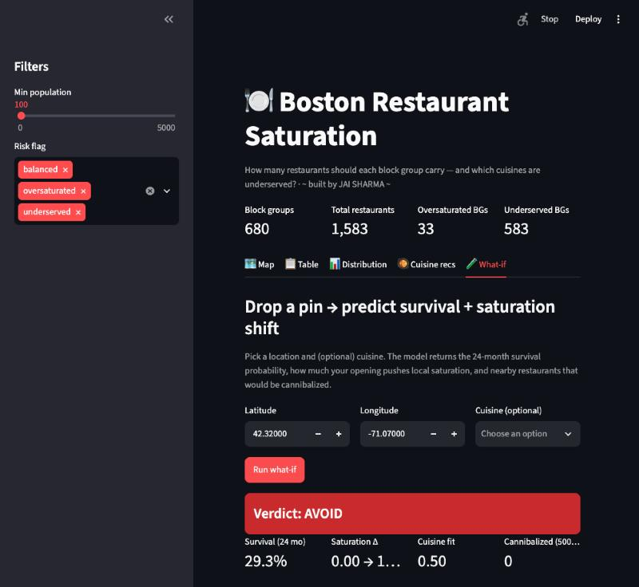
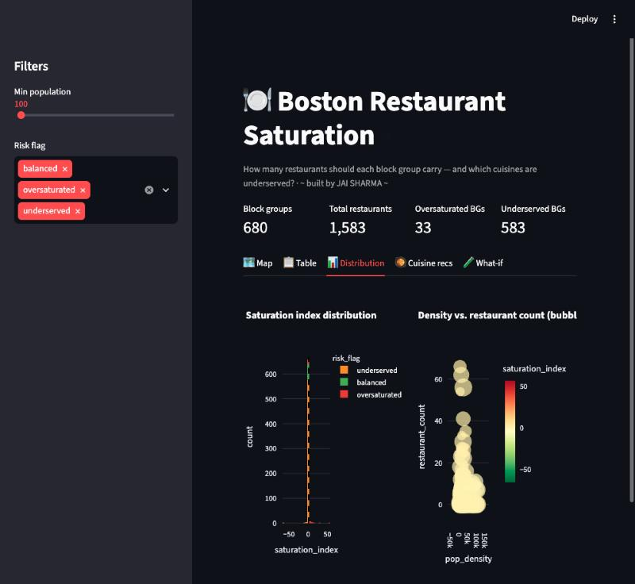
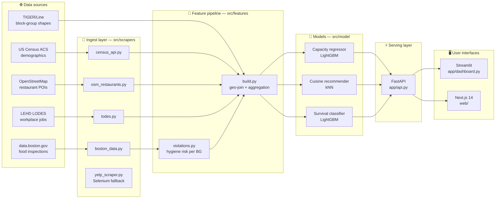
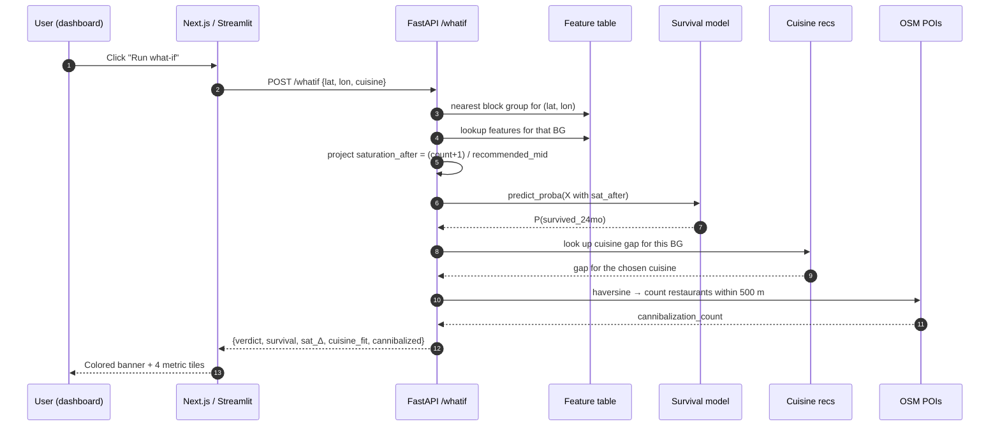
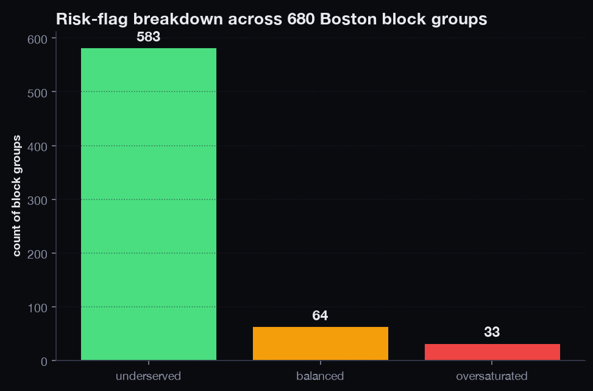
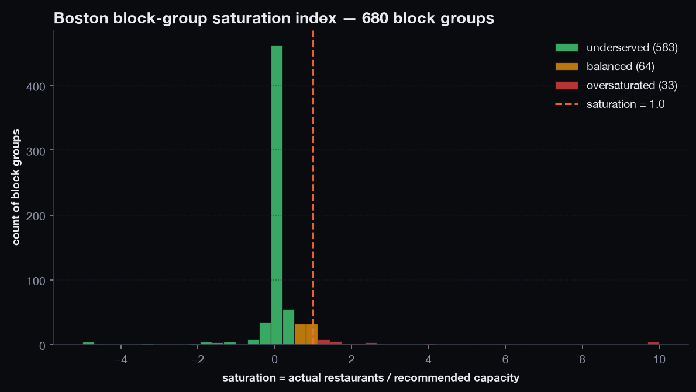
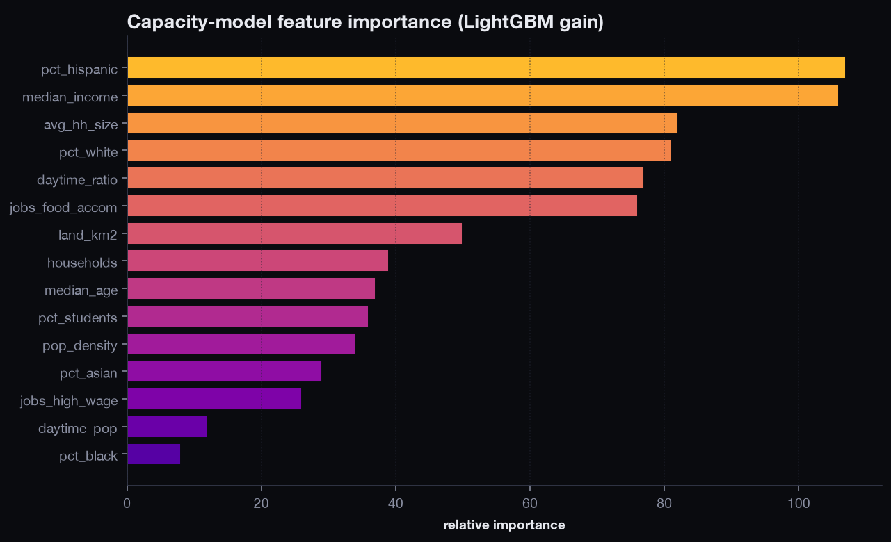
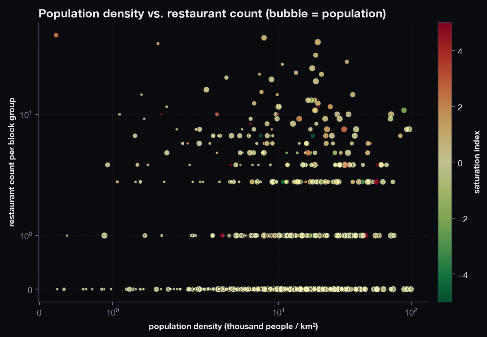
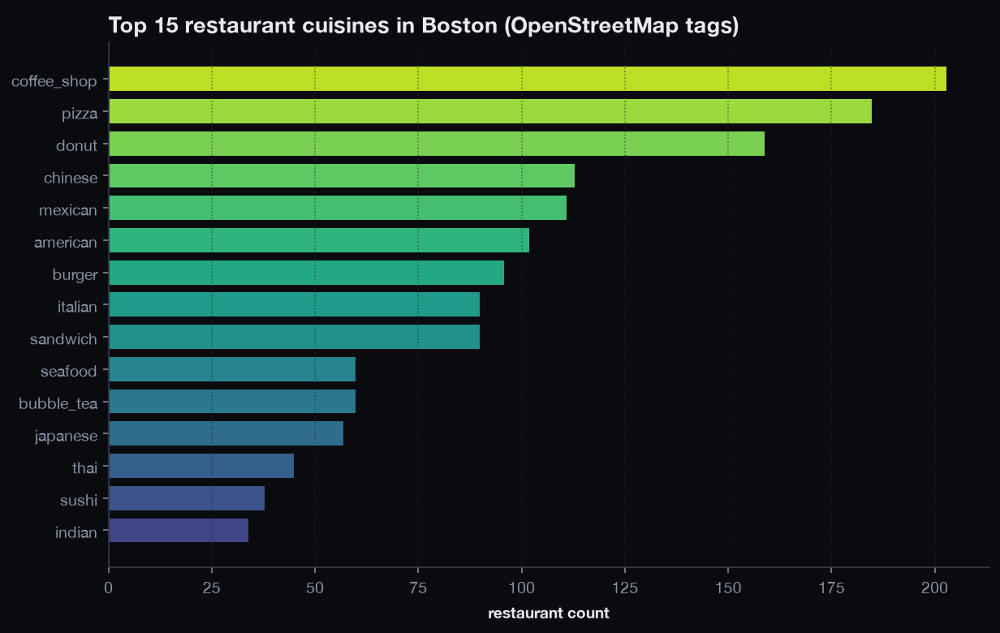

<div align="center">

# 🍽️ Boston Restaurant Saturation

### A full-stack geospatial ML system that tells you **how many restaurants a Boston neighborhood should carry** — and whether a new one will survive.

[](https://www.python.org/)
[](https://fastapi.tiangolo.com/)
[](https://nextjs.org/)
[](https://lightgbm.readthedocs.io/)
[](https://streamlit.io/)
[](LICENSE)

</div>

---

## 🧠 The thesis

A restaurant market has a **carrying capacity**. Exceed it and the whole ecosystem rots:

- Thinner margins → less hygiene investment → inspection failures
- Higher closure rates (18–24 month graveyard)
- Trash + pest issues scale faster than linearly with restaurant density
- Incumbents get cannibalized before the newcomer even breaks even

This project **measures that capacity for every one of Boston's 681 census block groups** and ships it as an interactive product.

---

## 📺 Live product

<p align="center">
  
  
</p>

- **Left:** the "what-if" simulator — drop a pin + cuisine, get a `GO / RISKY / AVOID` verdict with survival probability, saturation shift, and nearby cannibalization.
- **Right:** the distribution view — 680 Boston block groups bucketed by risk.

---

## 🏛️ System architecture



---

## 🔬 Model architecture

Three stacked models, each solving a different question.

```mermaid
flowchart TB
    FEAT[📦 Feature table<br/>681 BGs × 37 cols<br/>demographics + daytime pop + hygiene]

    subgraph CAP[1️⃣ Capacity model]
        CAP1[Filter → <i>healthy</i> BGs<br/>low violation + fail rate]
        CAP2[LightGBM regressor<br/>→ restaurants_per_1000]
        CAP3[±1σ residual band<br/>→ recommended_min / max]
    end

    subgraph CUI[2️⃣ Cuisine recommender]
        CUI1[kNN in demographic space<br/>over healthy BGs]
        CUI2[Mean cuisine distribution<br/>of neighbors]
        CUI3[Subtract local actual mix<br/>→ underserved cuisines]
    end

    subgraph SURV[3️⃣ Survival classifier]
        SURV1[Build business lifecycles<br/>from inspection first/last]
        SURV2[Label survived_24mo]
        SURV3[LightGBM binary classifier<br/>→ P(alive @ 24 mo)]
    end

    OUT[🎯 Per-BG output<br/>recommended_min / max<br/>saturation_index<br/>risk_flag<br/>cuisine_mix<br/>survival_proba]

    FEAT --> CAP
    FEAT --> CUI
    FEAT --> SURV
    CAP --> OUT
    CUI --> OUT
    SURV --> OUT
```

### What each model answers

| Model | Question | Algorithm | Output |
|---|---|---|---|
| **Capacity** | How many restaurants *should* this BG have? | LightGBM regressor trained only on healthy BGs | `recommended_min / max`, `saturation_index`, `risk_flag` |
| **Cuisine** | Which cuisines are underserved given the demographics? | kNN over healthy peers in demo space | Ranked gap list per BG |
| **Survival** | Will a new restaurant here still be open in 24 months? | LightGBM binary classifier on reconstructed lifecycles | `P(survived_24mo)` |

---

## 🔁 Request lifecycle — the "What-if" simulator

What happens when you drop a pin + cuisine in the dashboard:



---

## 📊 Results (on real Boston data)

### Risk-flag breakdown — 680 block groups


### Saturation index distribution


Most block groups are under the recommended capacity — Boston's restaurants cluster heavily in a few corridors (Downtown, Back Bay, Allston, JP). The red bars past `saturation = 1.0` are the oversaturated candidates most at risk of closure.

### What the model actually learned — feature importance


The top predictors of healthy carrying capacity are **demographics (Hispanic share, median income, average household size, white share)** and the **daytime-population ratio from LEHD jobs**. Classic "who lives here *and* who works here" split.

### Population density vs. restaurant count


Bubble size = population; color = saturation (green = underserved, red = oversaturated). The oversaturated red bubbles cluster at mid density with low population — exactly the commercial strips where supply has outrun residential demand.

### Boston's cuisine mix today


Coffee shops, pizza, donuts and Chinese dominate the raw OSM tags. The recommender's job is to find *which of these are underrepresented* in a specific demographic context.

---

## 🚀 Quickstart

### Prerequisites
- Python 3.11+
- Node 18+ (for the Next.js UI only)
- macOS users: `brew install libomp` (LightGBM needs it)
- Free [Census API key](https://api.census.gov/data/key_signup.html)

### Install & run

```bash
git clone https://github.com/jai0812/boston-restaurant-saturation.git
cd boston-restaurant-saturation

python -m venv .venv && source .venv/bin/activate
pip install -r requirements.txt

cp .env.example .env     # paste your Census key into CENSUS_API_KEY

python -m src.pipeline fetch       # ~5–8 min, pulls 4 open datasets
python -m src.pipeline features    # joins + aggregates per block group
python -m src.pipeline train       # trains capacity + cuisine + survival

# Option A — Streamlit (fastest)
PYTHONPATH=. streamlit run app/dashboard.py

# Option B — FastAPI + Next.js (prettier)
uvicorn app.api:app --port 8000 --reload     # terminal 1
cd web && npm install && npm run dev         # terminal 2
# → http://localhost:3000
```

### Generate your own charts

```bash
python scripts/generate_docs_charts.py
```

---

## 🔌 REST API

Once `uvicorn app.api:app` is running on `:8000`:

| Method | Endpoint | Purpose |
|---|---|---|
| `GET` | `/health` | Liveness probe |
| `GET` | `/stats` | City-wide totals |
| `GET` | `/blockgroups?risk=oversaturated&limit=500` | Filterable list |
| `GET` | `/blockgroup/{geoid}` | Full detail incl. cuisine recs |
| `POST` | `/whatif` | Simulate a new opening |

**Example:**
```bash
curl -X POST http://127.0.0.1:8000/whatif \
  -H 'Content-Type: application/json' \
  -d '{"lat":42.3550,"lon":-71.0656,"cuisine":"vietnamese"}'
```
```json
{
  "geoid": "250259817001",
  "survival_probability": 0.454,
  "saturation_before": 0.097,
  "saturation_after": 0.194,
  "cuisine_fit": 0.722,
  "cannibalized_restaurants": 92,
  "verdict": "risky"
}
```

---

## 📂 Project layout

```
boston-restaurant-saturation/
├── config/
│   └── settings.py              # API keys, paths, constants
├── data/
│   ├── raw/                     # untouched API dumps (parquet)
│   └── processed/               # features + predictions
├── src/
│   ├── scrapers/
│   │   ├── census_api.py        # ACS demographics
│   │   ├── osm_restaurants.py   # OSM Overpass restaurant POIs
│   │   ├── boston_data.py       # Boston food inspections
│   │   ├── lodes.py             # LEHD workplace jobs
│   │   └── yelp_scraper.py      # Selenium fallback
│   ├── features/
│   │   ├── build.py             # geo-join + aggregation
│   │   └── violations.py        # hygiene risk per BG
│   ├── model/
│   │   ├── capacity_model.py
│   │   ├── cuisine_recommender.py
│   │   └── survival_model.py
│   └── pipeline.py              # CLI entrypoint
├── app/
│   ├── api.py                   # FastAPI
│   └── dashboard.py             # Streamlit
├── web/                         # Next.js 14 + Tailwind + MapLibre
├── scripts/
│   └── generate_docs_charts.py
├── docs/                        # generated charts + screenshots
├── requirements.txt
├── LICENSE
└── README.md
```

---

## 🧮 Data sources

| Source | Why | Access |
|---|---|---|
| [US Census ACS 5-year](https://www.census.gov/data/developers/data-sets/acs-5year.html) | Population, age, income, race, students | Free API key |
| [OpenStreetMap Overpass](https://wiki.openstreetmap.org/wiki/Overpass_API) | Restaurant POIs + cuisine tags | Free, no key |
| [Analyze Boston — Food Inspections](https://data.boston.gov/dataset/food-establishment-inspections) | Hygiene violations, business lifecycle | Free CKAN API |
| [LEHD LODES WAC](https://lehd.ces.census.gov/data/) | Workplace jobs (daytime population) | Free, no key |
| [TIGER/Line](https://www.census.gov/geographies/mapping-files/time-series/geo/tiger-line-file.html) | Block-group polygons | Free, no key |

---

## 🧭 Roadmap

- [x] Capacity, cuisine, and survival models
- [x] FastAPI service
- [x] Streamlit + Next.js dashboards
- [x] What-if simulator
- [x] Documentation + generated charts
- [ ] LLM narrative layer (plain-English BG explanations)
- [ ] Lease-price integration (LoopNet scrape)
- [ ] MBTA walkability + isochrones
- [ ] Multi-city (NYC, SF, Chicago)
- [ ] Docker + Vercel/Railway deploy
- [ ] SHAP feature-importance page
- [ ] Pytest + GitHub Actions CI

PRs welcome.

---

## 📄 License

MIT — see [LICENSE](LICENSE).

---

## 🙏 Credits

Built by **[Jai Sharma](https://github.com/jai0812)**.
Data courtesy of the US Census Bureau, City of Boston, OpenStreetMap contributors, and the LEHD program.

```
                                                 J       A
                    IS                           HA     RM
                  AJAISH                         ARMAJAISHAR
                MAJAISHARM                      AJAI00SHARMAJAI
              SHARMAJAISHARM                   AJAISHARMAJAISHARMAJ
            AISHARMAJAISHARMAJ                AISHARMAJAISHARMAJAISHAR
          MAJAISHARMAJAISHARMAJA             ISHARMAJAISHARMA  JA  IS H
        ARMAJAISHARMAJAISHARMAJAIS          HARMAJAISHAR   MA  JA
      ISHARMAJAISHARMAJAISHARMAJAISH       ARMAJAISHAR
          MAJAISHARMAJAISHARMAJAISHARM    AJAISHARMA
 J           AISHARMAJAISHARMAJAISHARMAJAISHARM
 AJ        AISHARMAJAISHARMAJAISHARMAJAISHARMA
 JAI     SHARMAJAISHARMAJAISHARMAJAISHARMAJA
  ISHA  RMAJAISHARMAJAISHARMAJAISHARMAJAISH
   ARMAJAISHARMAJAISHARMAJAISHARMAJAISHAR
     MAJAISHARMAJAISHARMAJAISHARMAJAISH
        ARMAJAISHAR  MAJAISHA   RMAJAISH

            ~ built by JAI SHARMA ~
```
